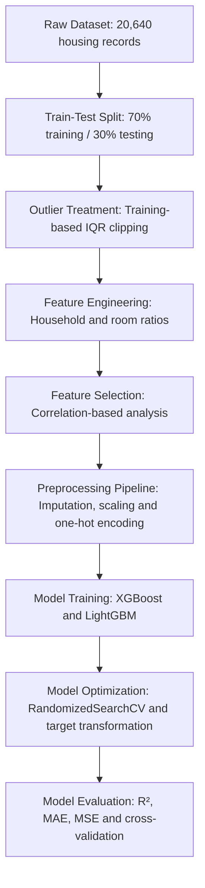
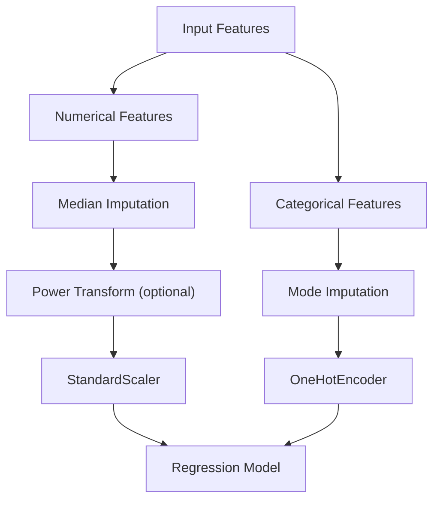

# California Housing Prediction


## Project Overview

A machine learning regression project for predicting median housing values in California using gradient boosting algorithms, advanced feature engineering, preprocessing pipelines, hyperparameter optimization, and target transformation techniques.

## Dataset

| Attribute | Value |
|---|---:|
| Total records | 20,640 |
| Raw input features | 9 |
| Training samples | 14,448 |
| Test samples | 6,192 |

The dataset includes geographic coordinates, housing characteristics, population, household counts, median income, and ocean proximity. The prediction target is `median_house_value`.

## Machine Learning Workflow



## Feature Engineering

| Engineered feature | Formula |
|---|---|
| rooms_per_household | Total rooms / Households |
| bedrooms_per_room | Total bedrooms / Total rooms |
| population_per_household | Population / Households |

Highly correlated features were analyzed using a correlation threshold of 0.90.

## Preprocessing Architecture



Yeo-Johnson transformation is used in the transformation experiment.

## Model Performance

| Model | Test R² |
|---|---:|
| **LightGBM** | **0.8410** |
| LightGBM + Target Transform | 0.8309 |
| XGBoost | 0.8120 |
| Tuned XGBoost | 0.8081 |

| Metric | Tuned XGBoost | LightGBM |
|---|---:|---:|
| Training R² | 0.8362 | 0.8874 |
| Test R² | 0.8081 | **0.8410** |
| Test MAE | 34,124.14 | **30,617.41** |
| Test MSE | 2.519 × 10⁹ | **2.087 × 10⁹** |

LightGBM achieved the highest reported test R² among the documented experiments. Hyperparameter optimization and target transformation did not improve test performance in these experiments.

## Hyperparameter Optimization

| Parameter | Value |
|---|---|
| Algorithm | XGBoost |
| Optimization | RandomizedSearchCV |
| Candidates | 40 |
| CV folds | 3 |
| Total fits | 120 |
| Scoring | Negative RMSE |

The tuned XGBoost estimator was also evaluated using 5-fold cross-validation, producing an approximate mean RMSE of 50,671.79 on the training data.

## Technologies

- Python
- Pandas & NumPy
- Scikit-learn
- XGBoost
- LightGBM
- SciPy
- Matplotlib & Seaborn
- Jupyter Notebook

## Repository Structure

```text
california-housing-prediction/
├── XGBoostRegressor.ipynb
└── README.md
```

## Getting Started

```bash
git clone https://github.com/blgmstf332/california-housing-prediction.git
cd california-housing-prediction
pip install pandas numpy matplotlib seaborn scikit-learn xgboost lightgbm scipy jupyter
jupyter notebook
```

Obtain the corresponding California Housing CSV dataset separately and place it at `MachineLearningDataSets/21-housing.csv`, or update the dataset path in the notebook.

## Limitations & Future Improvements

- Integrate outlier handling and feature engineering into the preprocessing pipeline.
- Perform all data-dependent preprocessing within cross-validation folds.
- Evaluate geographic generalization using spatial validation.
- Export the best-performing model as a reusable pipeline.
- Add a reproducible dependency file and dataset source documentation.
- Expand systematic model comparisons.

## Author

**Mustafa Kılıç**

Computer Engineering Student — Artificial Intelligence, Machine Learning & Data Science

[GitHub](https://github.com/blgmstf332)
